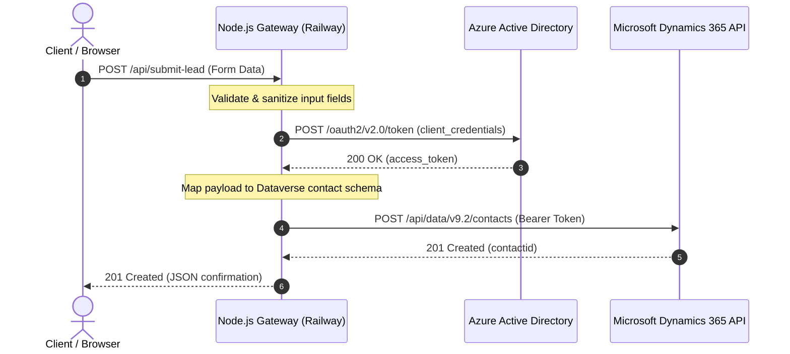

# Enterprise CRM Ingestion Gateway (Node.js + Dynamics 365)

A resilient, cloud-native Node.js microservice engineered to capture incoming web lead payloads and securely synchronize them into **Microsoft Dynamics 365 Web API (v9.2)** using Azure Active Directory OAuth 2.0 authentication.

---

## 📌 Architecture Overview

This gateway acts as a secure reverse-proxy middleware. It abstracts sensitive Azure Active Directory credentials from client-facing intake forms, normalizes heterogeneous form payloads into Microsoft Dataverse schemas, and handles upstream token lifecycles.

## ✨ Features

- **OAuth 2.0 Server-to-Server Authentication:** Negotiates Bearer tokens dynamically against Azure AD using the client_credentials grant flow.
- **Enterprise Schema Transformation:** Validates and maps frontend payload keys to strict Dynamics 365 Common Data Model (CDM) contact attributes (firstname, lastname, address1_*, telephone2, integer choice options, etc.).
- **Security & Secret Isolation:** Keeps tenant secrets and CRM endpoint details securely confined to server-side environment variables, preventing client-side exposure.
- **Micro-Frontend Interface:** Includes a self-contained, responsive glassmorphism UI featuring asynchronous lifecycle handling (button state transitions, input validation, and animated toast feedback).
- **Cloud Native:** Ready for containerized or PaaS deployment on Railway with automatic Git-triggered builds.

## 🛠 Tech Stack

- **Runtime & Server:** Node.js, Express.js
- **HTTP Client:** Axios
- **Identity & Auth:** Microsoft Azure Active Directory (OAuth 2.0 v2.0 endpoint)
- **CRM Target:** Microsoft Dynamics 365 Web API v9.2
- **Hosting / CI/CD:** Railway
